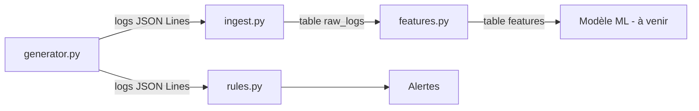

# 🛡️ Mini-SOC

Un mini centre de surveillance de sécurité : il analyse des logs de connexion, détecte les comportements suspects grâce au Machine Learning et permet de poser des questions en langage naturel à un assistant IA.

> 🚧 Projet en cours de construction.

## 🎯 Objectifs

Ce projet démontre cinq domaines de l'informatique :

| Domaine | Dans ce projet |
|---|---|
| Data Engineering | Pipeline d'ingestion et de stockage des logs |
| Machine Learning | Détection d'anomalies et évaluation des modèles |
| AI Engineering | Assistant LLM avec RAG |
| Architecture logicielle | API, services séparés, Docker |
| Cybersécurité | Thème du projet et sécurisation du système |

## 🗺️ Avancement

- [x] Mise en place du dépôt
- [x] Générateur de logs (connexions normales, force brute, compte volé)
- [x] Pipeline de données : chargement dans DuckDB et calcul des features en SQL
- [x] Première détection par règle
- [ ] Modèle de détection d'anomalies
- [ ] API et assistant IA
- [ ] Sécurisation et intégration continue

## ⚙️ Fonctionnement actuel



1. **`generator.py`** fabrique 340 logs de connexion SSH : des connexions normales, trois attaques par force brute et cinq connexions suspectes depuis des IP d'attaquants.
2. **`ingest.py`** charge ces logs dans une base **DuckDB** (table `raw_logs`).
3. **`features.py`** calcule en SQL des caractéristiques pour chaque connexion : heure, échec ou non, nombre de comptes essayés par l'IP, taux d'échec de l'IP…
4. **`rules.py`** applique une règle de détection : un même compte connecté depuis deux IP différentes en moins d'une minute.

## 🚀 Lancer le projet

```bash
git clone https://github.com/pierrarsuffi-ux/mini-soc.git
cd mini-soc
python -m venv .venv
.venv\Scripts\Activate.ps1        # Windows (sur macOS/Linux : source .venv/bin/activate)
pip install -r requirements.txt

python src/minisoc/generator.py   # génère les logs
python src/minisoc/ingest.py      # les charge dans DuckDB
python src/minisoc/features.py    # calcule les features
python src/minisoc/rules.py       # lance la règle de détection
```

## 📁 Structure du projet

```
mini-soc/
├── src/minisoc/
│   ├── generator.py   # génération des logs synthétiques
│   ├── ingest.py      # chargement dans DuckDB
│   ├── features.py    # calcul des features en SQL
│   └── rules.py       # détection par règle
├── data/              # données générées (non publiées)
├── requirements.txt
└── README.md
```

## 🔐 Choix de sécurité

- **Données synthétiques** : aucune donnée personnelle réelle. Les IP d'attaquants utilisent les plages réservées à la documentation (RFC 5737).
- **Requêtes SQL paramétrées** : protection contre les injections SQL.
- **Rien de sensible sur GitHub** : les données, la base et l'environnement virtuel sont exclus par le `.gitignore`.
- **Dépendances à version figée** dans `requirements.txt`, pour des installations reproductibles.

## 🛠️ Technologies

Python 3.12 · DuckDB · SQL